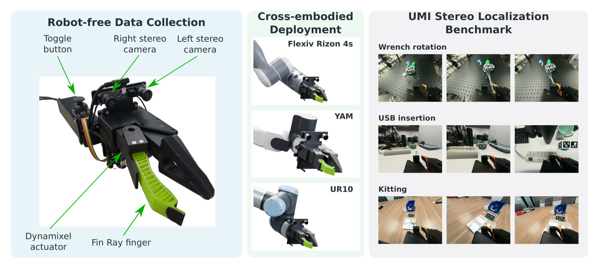

  <h1>OpenJaws: An Open Hardware UMI Framework with Stereo Localization for Generalist Manipulation</h1>

  
  
  
  

  

## Release History

Code + Dataset release is still pending. If you have any questions in the meantime, please post an issue in this repo.
